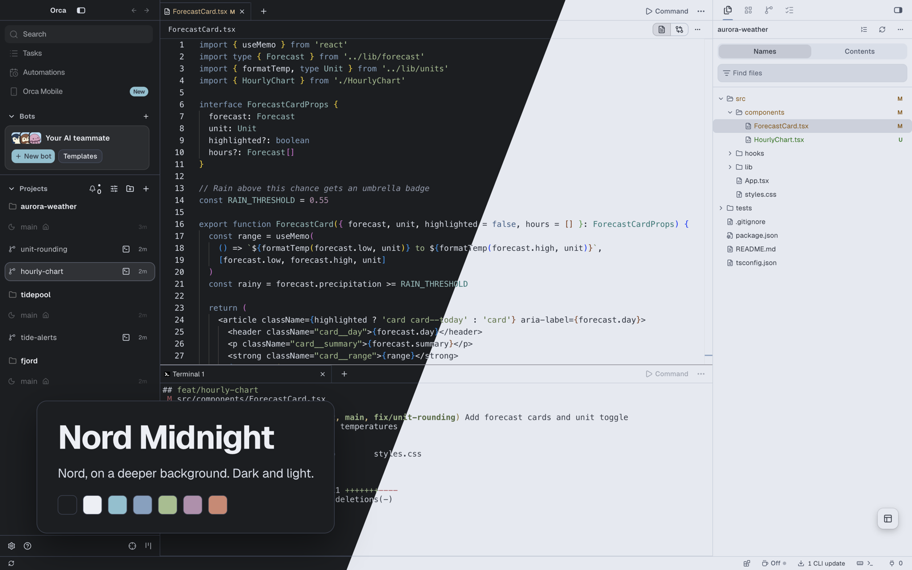
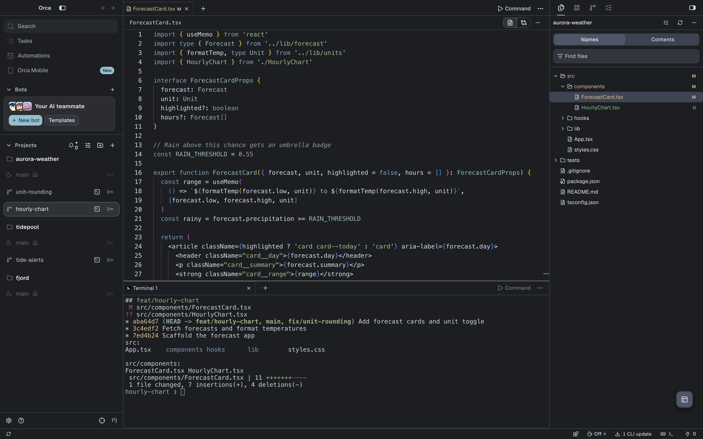
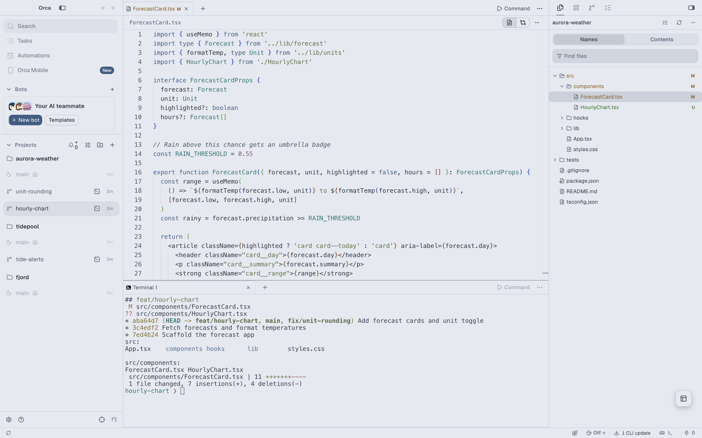

# Nord Midnight for Orca



Nord, on a deeper background that is easier on the eyes.

Nord Midnight is based on [Nord for Orca](https://github.com/stablyai/orca-plugins/tree/main/plugins/nord-theme), which follows the [Nord](https://www.nordtheme.com/) color palette. It keeps Nord's calm, low-contrast colors for text, syntax and accents, and replaces its blue-gray surfaces with one darker background. The editor, sidebars and tabs blend into a single quiet canvas, which is easier on the eyes during long sessions. It includes two themes:

- **Nord Midnight** (dark): Nord's text, syntax and accent colors on one deep background, `#1C1E21`, for the editor, sidebars, tabs, cards and menus, with quiet `#3B4252` borders between them.
- **Nord Midnight Light** (light): Nord's Snow Storm and Polar Night colors on one background, `#E5E9F0`, with syntax colors darkened so each one meets WCAG AA contrast (4.5:1).

Each theme comes with matching terminal colors.

## Screenshots

**Nord Midnight**



**Nord Midnight Light**



## Install

In Orca, open Settings → Plugins, search for **Nord Midnight** and install it. Then choose **Nord Midnight** or **Nord Midnight Light** in Settings → Appearance. The matching terminal colors are offered alongside each theme.

## Colors

| Part | Nord Midnight | Nord Midnight Light |
| --- | --- | --- |
| Background (editor, sidebars, tabs, cards, menus) | `#1c1e21` | `#e5e9f0` |
| Text | `#eceff4` | `#2e3440` |
| Hover and selection | `#434c5e` / `#4c566a` | `#d8dee9` |
| Borders and dividers | `#3b4252` | `#c8d0dc` |
| Text field and button outlines | `#434c5e` | `#b8c2d1` |
| Active tab underline | `#88c0d0` | `#5e81ac` |
| Your chat messages | `#2e3440` | `#d8dee9` |

Borders sit only a step above the background so panels stay distinct without drawing the eye. Text fields, selects and outlined buttons get a slightly stronger outline so they still read as things you can type into or click. In the dark theme, Orca also gives text fields a faint `#282c33` fill from that outline color.

Syntax colors in Nord Midnight Light:

| Scope | Color |
| --- | --- |
| Comments | `#4c566a` |
| Keywords | `#3b5e85` |
| Strings | `#577140` |
| Functions | `#0c7482` |
| Classes and types | `#1c7473` |
| Variables | `#2e3440` |
| Numbers | `#865b7f` |
| Constants | `#7f6614` |
| Tags | `#4b6c8c` |

Terminal colors:

| Color | Nord Midnight | Nord Midnight Light |
| --- | --- | --- |
| Background | `#1c1e21` | `#e5e9f0` |
| Text | `#d8dee9` | `#2e3440` |
| Cursor | `#88c0d0` | `#3b5e85` |
| Selection | `#434c5e` | `#c8d0dc` |
| Black / bright | `#3b4252` / `#616e88` | `#3b4252` / `#4c566a` |
| Red / bright | `#bf616a` / `#dc8088` | `#ae4751` / `#993e47` |
| Green / bright | `#a3be8c` / `#a3be8c` | `#567040` / `#4b6237` |
| Yellow / bright | `#ebcb8b` / `#ebcb8b` | `#7f6614` / `#775614` |
| Blue / bright | `#81a1c1` / `#81a1c1` | `#4b6c8c` / `#3b5e85` |
| Magenta / bright | `#b48ead` / `#b48ead` | `#865b7f` / `#774f6f` |
| Cyan / bright | `#88c0d0` / `#8fbcbb` | `#0c7482` / `#1c7473` |
| White / bright | `#e5e9f0` / `#eceff4` | `#5d6982` / `#7986a0` |

The dark terminal follows Nord's terminal colors, with bright black lifted to `#616e88` so dim text such as shell suggestions stays readable on the deeper background. In the light terminal every color except bright white meets WCAG AA contrast (4.5:1) on `#e5e9f0`, and the bright variants are deeper rather than lighter.

## Develop

```sh
orca plugin validate .
orca plugin dev load .
```

## License

MIT. Based on [Nord for Orca](https://github.com/stablyai/orca-plugins/tree/main/plugins/nord-theme) by Lovecast Inc. and the [Nord](https://www.nordtheme.com/) palette by Arctic Ice Studio.
